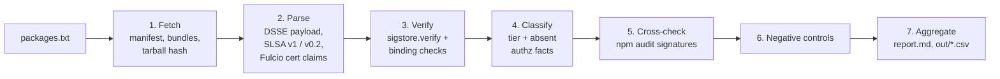

# provenance-gap

Measures the gap between what npm package provenance **attests** and what a
consumer might **assume** it guarantees.

## In plain English

When you install an npm package, you can't easily tell how it was built. npm
"provenance" fixes part of that: a package can ship with a signed record saying
*"this exact file was built by GitHub Actions, from this repository, at this
commit."* This project downloads those records for real, published npm
packages, checks that they verify cryptographically, and reads what they
actually say. Then it counts how often a package **passes** verification while
the record still tells you **nothing** about whether that build was authorized:
who started it, whether the branch was protected, or whether anyone approved it.
It measures the attestation format. It does not judge whether any package is
safe or malicious.

---

## Contents

- [The problem: the provenance gap](#the-problem-the-provenance-gap)
- [What this project measures](#what-this-project-measures)
- [How it works](#how-it-works)
- [Getting started](#getting-started)
- [Example output](#example-output)
- [Scope, limitations, and ethics](#scope-limitations-and-ethics)
- [Project layout](#project-layout)
- [References](#references)

---

## The problem: the provenance gap

### A short primer on SLSA and npm provenance

**SLSA** ("Supply-chain Levels for Software Artifacts", pronounced "salsa") is
a framework for describing how software was built. Its central artifact is a
**provenance attestation**: a small JSON document that says which builder
produced an artifact, from which source, using which build instructions.

**npm provenance** is npm's implementation of this. When a maintainer publishes
from a supported CI system (in this sample, always GitHub Actions) with
`npm publish --provenance` or trusted publishing, three things happen:

1. The CI job gets a short-lived identity token from GitHub (OIDC).
2. **Fulcio**, Sigstore's certificate authority, swaps that token for a
   short-lived signing certificate. The certificate embeds claims from the
   token, such as the repository, git ref, commit, and workflow file.
3. The SLSA provenance document is signed with that certificate and recorded in
   **Rekor**, Sigstore's public transparency log. npm stores the resulting
   "bundle" alongside the package, and the registry advertises it in the
   version's `dist.attestations` field.

Anyone can later check the signature, the certificate chain, and the log entry.
If they all verify, you know that the package tarball really came out of a
specific GitHub Actions run.

### The gap

Provenance answers *"where did this come from?"* It says, in effect:

> This tarball was produced by a run of workflow **W** in repo **R**, on ref
> **F** at commit **C**, triggered by event **E**, on runner type **X**.

That is an **origin** claim. It is easy to read it as more than that, as if
it also meant *"this was a legitimate, authorized release."* The format does
not carry the facts you would need to conclude that:

- whether ref **F** had branch protection or tag rulesets at build time,
- who triggered the run, or whether anyone approved it,
- whether the commit or workflow file was reviewed,
- whether inputs from outside the commit (caches, third-party actions) were
  trustworthy.

So a build that an attacker has subverted *from inside the legitimate
pipeline* still produces provenance with exactly the same fields as a normal
release, and it verifies.

### The motivating example: TanStack, May 2026

On 11 May 2026, malicious versions of 42 `@tanstack/*` npm packages were
published. Public reporting describes attacker-controlled code taking over a
runner inside TanStack's legitimate GitHub Actions release pipeline, so the
packages were published with the project's real CI identity, and **they shipped
with valid SLSA provenance**. Verification passed because the attestation's
claims were true: the packages *were* built by that repository's workflow. What
the attestation could not say was that the run was authorized.

This project was built around that observation. It asks how much of what we
see on npm today is in the same position: verifiable, but silent on
authorization.

> **Note.** The sample includes `@tanstack/react-query@5.103.2`, a later
> version published in September 2026. It is not one of the compromised
> versions, and nothing in this project analyses the compromised versions or
> says anything about the current package. It appears only as one more
> branch-published package.

---

## What this project measures

For each package in [`packages.txt`](packages.txt), the pipeline answers:

1. **Is provenance present?** Does the registry advertise an SLSA provenance
   attestation for this version?
2. **Does it verify?** Do the signature, certificate chain, certificate
   transparency, and Rekor inclusion all check out? Does the attestation
   describe *this* tarball, and do the certificate's claims agree with the
   document?
3. **What does it claim?** Repository, workflow file, git ref, commit,
   trigger event, builder, runner environment, and run ID.
4. **What does it *not* claim?** The tool searches every key in the
   provenance document and the certificate claims for anything that could
   record an authorization fact. These are the gap categories it checks
   ([`src/classify.mjs`](src/classify.mjs)):

   | Gap category | What a consumer might assume |
   |---|---|
   | Branch / tag protection | The ref had protection rules or rulesets at build time |
   | Trigger actor | We know who started the run |
   | Human approval | An environment reviewer signed off |
   | Review status | The commit or workflow file was reviewed / merged via PR |
   | Build-input integrity | Caches and third-party actions used were trustworthy |

5. **What does the trigger imply?** Some trigger events make it harder to
   reason about authorization. `workflow_dispatch` is a manual click whose
   author is not attested. `schedule` is a cron run that no person started.
   `pull_request_target`, `workflow_run`, `issue_comment`,
   `repository_dispatch` and `pull_request` can be influenced from outside the
   repository. These are flagged.

### Guarantee tiers

Each package is put into exactly one tier, using **only** what is in the
attestation. No GitHub API lookups are made, on purpose: the question is what a
consumer can learn from provenance alone.

| Tier | Meaning |
|---|---|
| `none` | The registry lists no SLSA provenance for this version. |
| `present-unverifiable` | Provenance is advertised or present, but some check failed (see failure kinds below). |
| `attests-origin-only` | Verifies, but nothing in it ties the build to a protected or release context. Every branch ref lands here, because branch protection is never attested, as does every manual, scheduled, or externally influenced trigger. |
| `attests-with-context` | Verifies, **and** the ref is `refs/tags/*`, **and** the trigger is `push` or `release`. This is the strongest tier, and it *still* can't confirm that the tag was protected or who created it. |

The classifier is deliberately conservative. There is no tier for "verified as
authorized", because the format gives the tool nothing to base it on.

### Failure kinds

When verification fails, every error is tagged so that a limitation of *this
tool* is never reported as a problem with *the package*:

| Kind | Meaning |
|---|---|
| `[signature]` | Sigstore rejected the bundle (signature, Fulcio chain, CT, or Rekor inclusion). |
| `[binding]` | The signature is fine, but the signed claims don't describe this tarball, or the certificate disagrees with the provenance document. |
| `[parser]` | This tool couldn't extract the fields it needs from the format. This is a tool gap, not evidence against the package. |
| `[fetch]` | The registry advertised a bundle that couldn't be retrieved. |

---

## How it works



The entry point is [`src/pipeline.mjs`](src/pipeline.mjs). The order in the
code is fetch → parse → verify → classify → aggregate. Parsing and verification
both happen inside a single function, `evaluate()`, in
[`src/verify.mjs`](src/verify.mjs).

### 1. Fetch ([`src/pipeline.mjs`](src/pipeline.mjs))

For each line of `packages.txt` (`name` means the latest version, `name@version`
pins one), up to six packages are processed in parallel:

- the version manifest from `https://registry.npmjs.org/<name>/<version|latest>`
- the attestation bundles from the manifest's `dist.attestations.url`
- the package tarball, which is downloaded and hashed with SHA-512. This only
  happens when there is provenance to bind it to.
- npm's registry signing keys from `https://registry.npmjs.org/-/npm/v1/keys`

Everything is cached under `cache/<pkg>/`, so re-runs are stable and offline
apart from Sigstore's trust root. `--refresh` re-resolves and re-fetches.

### 2. Parse ([`src/verify.mjs`](src/verify.mjs), [`src/cert.mjs`](src/cert.mjs))

- Decodes the DSSE envelope payload, which is the in-toto statement holding the
  SLSA predicate.
- Extracts repo, workflow path, ref, commit, trigger event, builder ID, and run
  invocation. Two formats are handled:
  - **SLSA v1** (`github-actions-buildtypes/workflow/v1`), the current format
  - **SLSA v0.2** (`npm/cli/gha@v1`, `npm/cli/gha/v2`), used by npm in 2023
- Parses the Fulcio signing certificate with a small DER walker, pulling out
  Sigstore's OIDC-claim extensions. These include the current v2 OIDs
  (`1.3.6.1.4.1.57264.1.8`–`.22`) and the legacy GitHub OIDs (`.1`–`.6`) that
  older certificates carry.

### 3. Verify ([`src/verify.mjs`](src/verify.mjs))

- **Cryptographic:** `sigstore.verify()` from the
  [`sigstore`](https://www.npmjs.com/package/sigstore) JS library checks the
  signature, the Fulcio certificate chain, the signed certificate timestamp, and
  Rekor inclusion. It uses the Sigstore public-good trust root fetched via TUF
  (cached in `cache/_tuf/`).
- **Binding:** the statement's subject must be `pkg:npm/<name>@<version>`.
  Its SHA-512 must equal the registry's `dist.integrity`, which must equal the
  hash of the tarball actually downloaded.
- **Certificate ↔ predicate:** the certificate's repository, ref, commit, and
  trigger must equal the provenance document's. The certificate's
  `buildConfigURI` must equal `<repo>/<workflow>@<ref>`.
- **Publish attestation:** npm's separate publish attestation is verified
  against the registry's own keys.

A package counts as *verified* only if the signature passes **and** there are
no binding or parser errors.

### 4. Classify ([`src/classify.mjs`](src/classify.mjs))

Assigns the tier and records which of the five authorization facts are absent,
with a human-readable reason for each decision.

### 5. Cross-check with `npm audit signatures` ([`src/pipeline.mjs`](src/pipeline.mjs))

As an independent check with the consumer-facing tool, the exact versions are
installed into a throwaway project at `cache/_npm-audit/`. Lifecycle scripts are
disabled (`--ignore-scripts`), and optional and peer dependencies are skipped.
Then `npm audit signatures --json` runs. This is the slowest step, and
`--skip-npm-audit` turns it off.

### 6. Negative controls ([`src/controls.mjs`](src/controls.mjs))

Real cached bundles are tampered with in known ways and fed through the same
`evaluate()` function. Each control declares the tier and failure kind it must
produce:

| Control | What is done | Must produce |
|---|---|---|
| `baseline-real` | unmodified `sigstore` bundle (branch) | `attests-origin-only` |
| `tagged-real` | unmodified `hono` bundle (tag) | `attests-with-context` |
| `legacy-v0.2-real` | unmodified 2023 `sigstore@1.5.0` bundle | `attests-origin-only` |
| `tampered-ref` | ref rewritten `refs/heads/main` → `refs/tags/v5.0.0` | `present-unverifiable [signature]` |
| `stripped-tlog` | Rekor entries removed | `present-unverifiable [signature]` |
| `wrong-tarball` | valid bundle, different tarball bytes | `present-unverifiable [binding]` |
| `swapped-bundle` | another package's valid bundle | `present-unverifiable [binding]` |
| `unknown-format` | unrecognised predicate type | `present-unverifiable [parser]` |
| `bundle-404` | attestation URL returns 404 | `present-unverifiable [fetch]` |
| `no-attestations` | `dist.attestations` removed | `none` |

If **any** control fails, or a fixture is missing from the cache, the run exits
non-zero and the report says not to trust it.

### 7. Aggregate ([`src/report.mjs`](src/report.mjs))

Writes `report.md`, which contains:

- headline counts and percentages, and per-tier counts
- a per-package table
- a "hand-check these" list
- per-package reasons
- a "does / doesn't attest" summary
- the controls table
- the tier rules and caveats

It also writes one CSV per package plus `out/summary.csv` and
`out/negative-controls.json`.

---

## Getting started

### Prerequisites

- **Node.js** and **npm**. The pinned dependency `sigstore@5.0.0` declares
  `node: ^22.22.2 || ^24.15.0 || >=26.0.0`, so use one of those versions.
  (Older docs in this repo said Node ≥ 20. That is out of date. The code also
  needs the built-in `fetch`.) On Node 24.5.0, npm prints an `EBADENGINE`
  warning but the test suite still passes. Treat that as unsupported anyway.
- **Network access** to `registry.npmjs.org` and to Sigstore's TUF trust root.
- **Optional:** Docker, if you'd rather not install Node locally.

### Install

```bash
git clone https://github.com/raahulkurmi/Provenance_gap.git
cd Provenance_gap
npm install --ignore-scripts
```

`run.sh` installs dependencies automatically if `node_modules/sigstore` is
missing, so the explicit install is optional.

### Run

Run the whole pipeline. It uses `cache/` where present, then prints `report.md`:

```bash
./run.sh
```

Skip the `npm audit signatures` cross-check, which is the slowest step:

```bash
./run.sh --skip-npm-audit
```

Re-resolve the latest versions and re-fetch everything, ignoring the cache:

```bash
./run.sh --refresh
```

Run inside a throwaway `node:24-slim` container instead of your local Node:

```bash
./run.sh --docker
```

Flags can be combined with `--docker`, for example:

```bash
./run.sh --docker --skip-npm-audit
```

`npm start` runs the same pipeline without the install check or printing the
report:

```bash
npm start
```

### Run only the negative controls

This needs a populated cache, which is committed in this repo, so it works on a
fresh clone. It does fetch npm's registry keys.

```bash
npm test
```

### Analyse different packages

Edit [`packages.txt`](packages.txt). Put one entry per line. Lines starting
with `#` are ignored.

```text
# latest version
left-pad
# a pinned version
sigstore@1.5.0
```

Then run with `--refresh` if you want "latest" entries re-resolved:

```bash
./run.sh --refresh
```

Progress and any "not verified" packages are logged to stderr, prefixed with
`[provenance-gap]`.

---

## Example output

These are the committed results in [`report.md`](report.md), generated
2026-09-24 from 30 entries in `packages.txt`. Provenance-bearing packages come
from 17 distinct GitHub owners. **The sample was hand-picked to exercise every
tier, so the percentages describe this sample, not npm as a whole.**

### Headline

- Of **30** packages, **26 (87%)** publish SLSA provenance.
- Of those, **26 (100%)** verify (Sigstore signature, Fulcio chain, and Rekor
  inclusion; subject digest matches the tarball; certificate identity matches
  the predicate).
- Of the verified, **19 (73%)** are **origin-only**: they pass verification,
  but nothing in the attestation ties the build to a protected or authorized
  context.
- **7 (27%)** show a tagged-release context. Even these do not attest that the
  tag was protected or who created it.

| tier | count | share of all |
|---|---|---|
| none | 4 | 13% |
| present-unverifiable | 0 | 0% |
| attests-origin-only | 19 | 63% |
| attests-with-context | 7 | 23% |

Negative controls: **10/10 passed**. Every installed package also showed
`no errors` under `npm audit signatures`.

### What the verified attestations do and don't contain (26 packages)

| Authorization fact | Absent in |
|---|---|
| Branch/tag protection or ruleset state at build time | 26 / 26 |
| Identity of the actor who triggered the run | 25 / 26 |
| Human approval / environment reviewer sign-off | 26 / 26 |
| Review status of the commit or workflow file | 26 / 26 |
| Integrity of build inputs outside the commit | 26 / 26 |

The one exception for "actor" is `@sigstore/protobuf-specs@0.1.0`, a pinned
2023 package in the older SLSA v0.2 format. That format copied the CI
environment into the document, including a numeric `GITHUB_ACTOR_ID`. The
current SLSA v1 format, used by all 24 other verified packages, does not
include it.

Other observations from the same run:

- **Triggers:** `push` ×20, `workflow_dispatch` ×3 (zod, react,
  @prisma/client), `release` ×2, `schedule` ×1 (typescript-eslint).
- **Refs:** `refs/heads/main` ×18, `refs/tags/*` ×7, `refs/heads/v7` ×1
  (@prisma/client). The attestation can't distinguish a maintained release
  branch from any other branch.
- **Reusable workflows:** for 2 packages (semver, pacote), the workflow that
  actually signed differs from the top-level workflow named in the predicate.
  The signing workflow appears only in the certificate, which a consumer
  reading the SLSA predicate never sees.

### A row from `out/summary.csv` (truncated)

```csv
spec,name,version,provenancePresent,verified,predicateType,buildType,sourceRepo,workflowPath,...,ref,commit,event,...,tier,...
sigstore,sigstore,5.0.0,true,true,https://slsa.dev/provenance/v1,https://slsa-framework.github.io/github-actions-buildtypes/workflow/v1,https://github.com/sigstore/sigstore-js,.github/workflows/release.yml,...,refs/heads/main,7d2900eca1c2...,push,...,attests-origin-only,...
```

### `npm test` output (excerpt)

```text
PASS  baseline-real      expected attests-origin-only                got attests-origin-only
PASS  tampered-ref       expected present-unverifiable [signature]   got present-unverifiable [signature,binding]
      [signature] sigstore: DSSE payload hash mismatch
PASS  swapped-bundle     expected present-unverifiable [binding]     got present-unverifiable [binding]
      [binding] no subject named pkg:npm/sigstore@5.0.0 (subjects: pkg:npm/%40sigstore/bundle@5.0.0)
```

The `tampered-ref` control shows why the gap matters. The tool can detect
someone *editing* an attestation to claim a tag release. It cannot detect a
build that legitimately ran on a branch but was not authorized, because nothing
in the attestation describes authorization.

---

## Scope, limitations, and ethics

- **This project never says that any package is malicious or unsafe.** It
  measures what the attestation *format* records and whether it verifies.
  Every package in the sample may well have been built entirely legitimately.
- "Cannot determine authorization from provenance" describes **the format as
  npm publishes it today**. It says nothing about any maintainer's practices.
  Branch rules, tag rulesets, and environment reviewers may well be in place.
  The attestation simply doesn't carry them.
- A package in `none` has not published provenance for that version. That is a
  fact about the attestation, not a safety judgement.
- `[parser]` failures are limitations of this tool, not evidence against a
  package.
- **Public artifacts only.** Inputs are the public npm registry, public Sigstore
  infrastructure, and public npm keys. No GitHub API calls, credentials, or
  private data are used. Package install scripts are never run
  (`--ignore-scripts` everywhere).
- **Sample, not census.** The 30 entries were chosen to cover every tier.
  Some were picked *because* they publish from tags, publish no provenance, or
  use the 2023 format. The percentages describe this sample, not npm.
- **Point in time.** Unpinned entries mean "latest at fetch time" (2026-09-24
  for the committed cache). Re-running with `--refresh` may give different
  versions and numbers.
- **Not a SLSA-level assessor.** The tool does not compute or assign SLSA Build
  Levels. It reports the fields present and whether they verify.
- **Heuristic "absent" check.** An authorization fact is reported absent when no
  key in the predicate or certificate claims matches a pattern for it. This
  finds fields that *could* carry the fact. It does not prove the value would
  be meaningful if present.
- **GitHub Actions only, in practice.** Every provenance-bearing package in the
  sample was built on GitHub-hosted runners. Other CI providers are not
  exercised.

---

## Project layout

```text
packages.txt              packages to analyse (name or name@version)
run.sh                    one-command runner (--refresh, --skip-npm-audit, --docker)
package.json              single dependency: sigstore@5.0.0
src/pipeline.mjs          fetch, cache, orchestrate, npm audit cross-check, CSV output
src/verify.mjs            evaluate(): parse predicate, sigstore.verify, binding checks
src/cert.mjs              DER parser for Fulcio certificate OIDC-claim extensions
src/classify.mjs          guarantee tiers and authorization-fact search
src/controls.mjs          negative/positive controls built from real cached bundles
src/report.mjs            writes report.md
test/negative-controls.mjs   `npm test` entry point
report.md                 generated report (committed)
out/                      <pkg>.csv, summary.csv, negative-controls.json
cache/<pkg>/              version.json, attestations.json (raw bundles),
                          tarball.sha512.json, parsed.json (decoded statement,
                          certificate claims, Rekor entry), result.json
cache/_tuf/, cache/_npm-audit/   local-only scratch (git-ignored)
```

---

## References

- SLSA framework: <https://slsa.dev/>
- SLSA provenance specification v1.0: <https://slsa.dev/spec/v1.0/provenance>
- GitHub Actions build type for SLSA v1:
  <https://slsa-framework.github.io/github-actions-buildtypes/workflow/v1>
- npm docs, *Generating provenance statements*:
  <https://docs.npmjs.com/generating-provenance-statements>
- npm attestation specs (publish and provenance):
  <https://github.com/npm/attestation>
- Sigstore: <https://www.sigstore.dev/>. Fulcio OID reference:
  <https://github.com/sigstore/fulcio/blob/main/docs/oid-info.md>
- `sigstore` JS library: <https://github.com/sigstore/sigstore-js>
- TanStack incident coverage (May 2026):
  - CybelAngel, *TanStack npm supply-chain attack: 42 packages compromised with
    valid SLSA provenance*: <https://cybelangel.com/blog/tanstack-npm-supply-chain-attack/>
  - Snyk, *TanStack npm packages compromised*:
    <https://snyk.io/es/blog/tanstack-npm-packages-compromised/>
